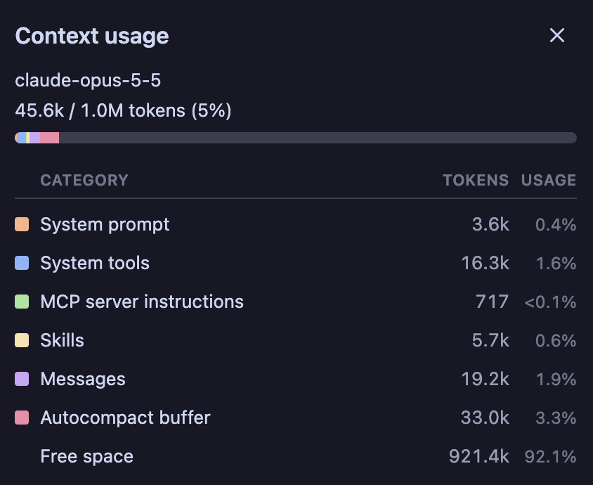
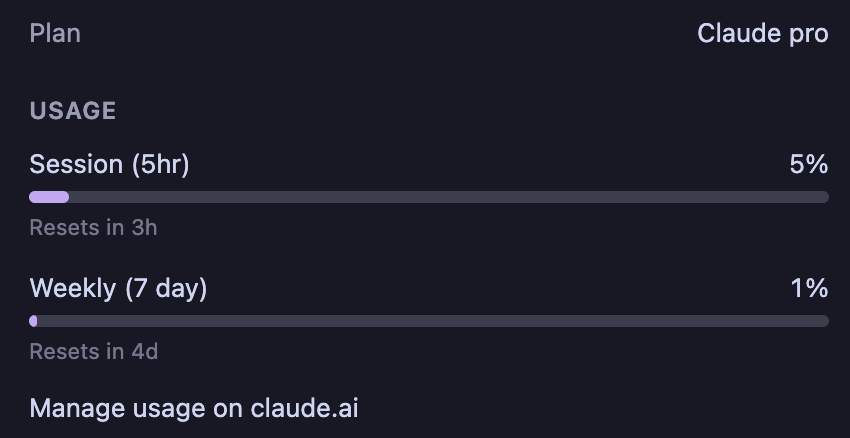

# Contexto y herramientas

Curso introductorio · Tema 2

---

## Lo que el modelo lee

En el tema 1: **toda la conversación se reenvía cada vez**.

**¿Qué hay exactamente en lo que lee?**

**Dirigir bien a un agente es, en gran parte, decidir qué entra en su mesa.**

---

## La ventana de contexto es una mesa

- Todo lo que el modelo ve en una llamada, **y nada más**
- Espacio limitado
- La carpeta es lo que **puede alcanzar**; la mesa, lo que **tiene enfrente**

---

## Qué hay en la mesa

```text
SIEMPRE
  Instrucciones del harness (cómo comportarse)
  AGENTS.md
  Lista de herramientas (+ las de cada MCP)
  Nombre y descripción de cada skill

CRECE
  La conversación: tus mensajes y sus respuestas
  Resultados de herramientas: archivos leídos, …

SI APLICA
  Una skill completa, solo si se usó (y desde ahí se queda)

ESPACIO LIBRE  ← se acaba
```

---

## Tres consecuencias

- **Se llena:** el harness *compacta* (resume) y pierde detalles
- **Se degrada antes de llenarse:** con mucho encima, lo importante se pierde (*context rot*)
- **Se borra:** sesión nueva = mesa vacía, salvo lo de "siempre"

---

## Tokens

Token = un pedazo de palabra. La mesa y tu plan se miden en tokens.

```text
Paso 1:  instrucciones + mensaje        → pide el archivo
Paso 2:  instrucciones + mensaje + respuesta del paso 1
Paso 3:  instrucciones + mensaje + respuesta del paso 1 + paso 2
```

La respuesta del paso 1 es el archivo enorme: se **vuelve a pagar** en cada paso.

---

## El contexto no es gratis

Todo lo que entra a la mesa se paga dos veces:

- En **tokens**: se reenvía en cada paso
- En **calidad**: compite por la atención del modelo

---

## Context rot

Conforme la mesa se llena, el modelo **rinde peor**: sigue instrucciones con menos cuidado, mezcla lo viejo con lo nuevo, se le escapan detalles.

- Empieza mucho antes de llenarse: se nota desde **~20–25 %** de la ventana
- El número cambia según modelo y tarea; la idea no

En Claude Code: `/context` muestra cuánto llevas.

--

## `/context`



Las categorías son las de la mesa. Más de la mitad es lo de "siempre".

---

## Las sesiones largas se comen tu plan

- El mensaje 40 cuesta mucho más que el 4
- Y trabaja con la mesa más degradada

**Pagas más por un resultado peor.**

--

## `/usage`



Dos límites: cada 5 horas y semanal. *Session* = ventana de 5 horas, no una conversación.

---

## El tradeoff

```text
Poco contexto                 Demasiado contexto
  no sabe lo que necesita       se pierde entre tanto
  adivina o inventa             olvida instrucciones
                                gasta tu plan más rápido

              ↑ el punto óptimo:
          lo justo para esta tarea
```

---

## El criterio: tareas pequeñas

**Parte el trabajo para que cada tarea quepa con holgura en una mesa limpia.**

- **Una tarea, una sesión**
- Si es grande, **divídela** en pasos que se revisan por separado
- Lo que pasa a la siguiente sesión, **en un archivo**
- Si empieza a olvidar: **resumen y sesión nueva**, no insistas

---

## Cinco piezas

1. Tool
2. MCP
3. Skill
4. Subagente
5. `AGENTS.md`

Para cada una: **¿qué ocupa en la mesa?**

---

## Tool = una mano

Agrega una **acción**. Nombre, entradas, resultado. Para el agente: caja negra.

```text
leer_archivo(ruta)
ejecutar(comando)
buscar_web(consulta)
```

- **En la mesa:** su descripción, siempre; y lo que devuelve, cada vez que se usa
- **Error común:** pedirle algo sin tool (y que lo invente), o aceptar sin leer el permiso

---

## MCP = un enchufe que trae manos

Protocolo (reglas comunes) para conectar un servidor externo (un programa que atiende pedidos) que ofrece **tools**. Sirve en Claude Code, Codex, Gemini…

```text
Calendario por MCP → crear_evento, listar_eventos
```

- **En la mesa:** todas sus tools, **siempre** (en la mayoría de los agentes); y lo que devuelven, cada vez que se usan
- **Error común:** instalar 10 "por si acaso"

---

## Skill = una receta del cajón

Agrega **saber hacer**: un `SKILL.md` con pasos, formato y criterio. Puede traer scripts.

```text
reporte-mensual/
  SKILL.md          ← pasos y formato
  limpiar_datos.py  ← los pasos fijos
```

- **No agrega acciones:** usa las que ya hay. Si la skill dice "corre este script", el agente lo corre con la tool `ejecutar`
- **En la mesa:** solo nombre y descripción
- **Error común:** meter el procedimiento en `AGENTS.md`

--

## Texto o script

- **Determinista** (da siempre el mismo resultado) **y repetible** → código (script)
- **Requiere criterio** → texto de la skill

---

## Subagente = otra persona con su mesa

Otro ciclo con la **mesa vacía**. Le delegas; regresa el resultado, no el desorden.

```text
Tú:        Revisa estos 200 archivos y dime dónde se calcula el IVA.
Subagente: ventas.py, factura.py y reportes/iva.py.
```

- **En la mesa:** tu encargo y su respuesta

**Si solo te importa la conclusión, no el camino → delégalo.**

--

## Tu mesa, antes y después

```text
SIN SUBAGENTE              CON SUBAGENTE
  siempre                    siempre
  archivo 1 leído            encargo (2 líneas)
  archivo 2 leído            respuesta (3 líneas)
  …                          ESPACIO LIBRE
  archivo 200 leído
  respuesta (3 líneas)

→ mesa llena,              → mesa limpia
  y apenas empiezas          para seguir
```

**Ojo:** no siempre ahorra tokens (la búsqueda se paga igual y armar su mesa cuesta). Lo que seguro ahorra es **tu** mesa.

--

## ¿Delegar o no?

**Sí, cuando…**

- La respuesta es corta, pero buscarla es largo
- Hay mucha lectura que no vas a necesitar (registros, PDFs)
- Son tareas independientes → en paralelo
- Quieres una segunda opinión limpia (no ve tus supuestos)

**No, cuando…**

- La tarea es pequeña
- Vas a necesitar los detalles
- Depende de lo que ya platicaron

--

## Cómo pedirlo

"**Usa un subagente para…**" — no cuentes con que decida solo.

Objetivo + contexto + terminado. Para un subagente, terminado = **qué te regresa y en qué forma**

❌ "Usa un subagente para revisar el IVA."

✅ "Usa un subagente para buscar en `src/` (la carpeta del proyecto) dónde se calcula el IVA (16 % en facturas)."

"Regrésame solo las rutas y una línea por cada una."

En el tema 4, superpowers los usa.

---

## `AGENTS.md` = la nota pegada en la mesa

Reglas que aplican **siempre**. Se lee en cada llamada.

```markdown
- Responde en español.
- Nunca borres la carpeta `datos/`.
```

No todos lo leen. Crea el de tu agente:

- **Codex:** `AGENTS.md`
- **Claude Code:** `CLAUDE.md` (puede tener solo la línea `@AGENTS.md` para importarlo)
- **Gemini CLI:** `GEMINI.md`

- **En la mesa:** todo, siempre
- **Error común:** hacerlo largo (se paga siempre)

---

## Resumen

| Pieza | Agrega | En la mesa |
|---|---|---|
| Tool | Una acción | Descripción, siempre; lo que devuelve, al usarse |
| MCP | Tools de afuera | Todas sus tools, siempre; lo que devuelven, al usarse |
| Skill | Saber hacer | Nombre y descripción; completa si se usa |
| Subagente | Una mesa aparte | Encargo y resultado |
| `AGENTS.md` | Reglas | Todo, siempre |

---

## ¿Dónde va cada cosa?

```text
¿Le falta una acción?             → Tool (de afuera: vía MCP)
¿Le falta saber cómo hacerlo?     → Skill (pasos fijos: script)
¿Llenaría tu mesa y solo te       → Subagente
 importa la conclusión?
¿Es una regla que aplica siempre? → AGENTS.md
¿Es solo para esta vez?           → Dilo en tu mensaje
```

---

## La memoria del agente son archivos

- El modelo no recuerda nada entre sesiones
- Sobrevive lo que quedó **escrito**: `AGENTS.md`, skills, specs (qué se va a construir; tema 4), el historial de commits (tema 3)
- Tema 4: la spec y el plan viven en archivos
